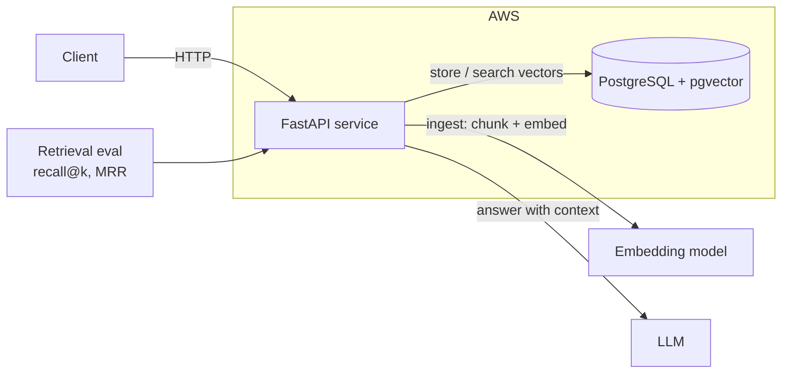

# RAG Platform

A production-style Retrieval-Augmented Generation API: FastAPI, PostgreSQL with pgvector, Docker, CI/CD and AWS deployment, with retrieval quality measured by an evaluation suite.

> **Status:** work in progress. See the [roadmap](#roadmap).

## Why

Plenty of RAG tutorials end in a notebook. This project focuses on what it takes to run RAG as a backend service: a clean API, a real database, migrations, tests, containers, CI/CD, cloud deployment, observability and numbers that show whether retrieval is actually good.

## Architecture



## API

| Method | Path | Description |
|---|---|---|
| `GET` | `/health` | Liveness check |
| `POST` | `/documents` | Ingest a document: split into chunks, embed and store |
| `POST` | `/search` | Semantic search: top-k chunks for a query |
| `POST` | `/ask` | Answer a question using retrieved chunks as context (planned) |

## Getting started

Requires Docker and [uv](https://docs.astral.sh/uv/).

```bash
git clone https://github.com/Mirelasbianchi/rag-platform.git
cd rag-platform
cp .env.example .env          # add your API key
docker compose up --build     # API on http://localhost:8000, docs on /docs
```

Run locally without Docker for the API (database still in Docker):

```bash
docker compose up -d db
uv sync
uv run uvicorn app.main:app --reload
```

## Project structure

```
rag-platform/
├── app/
│   ├── main.py        # FastAPI routes
│   ├── config.py      # settings from environment variables
│   ├── db.py          # PostgreSQL + pgvector access
│   └── rag.py         # chunking and embeddings
├── db/init.sql        # schema and vector index
├── eval/              # retrieval evaluation (recall@k, MRR)
├── tests/
├── infra/             # AWS deployment notes and IaC (planned)
├── Dockerfile
├── docker-compose.yml
└── .github/workflows/ # CI: lint, tests, image build
```

## Retrieval evaluation

`eval/retrieval_eval.py` takes a set of questions with the document each one should retrieve and reports **recall@k** and **MRR**. Every change to chunking, embeddings or search (e.g. adding hybrid search or reranking) should be compared on these numbers.

## Roadmap

- [x] Project skeleton: API, database schema, Docker, CI
- [ ] Ingestion of PDFs and Markdown with better chunking (by section, with overlap)
- [ ] `/ask` endpoint with citations to the retrieved chunks
- [ ] Hybrid search (pgvector + PostgreSQL full-text) and reranking
- [ ] Retrieval eval dataset over a public corpus (e.g. Brazilian public legal documents)
- [ ] Database migrations with Alembic
- [ ] Deploy on AWS (ECS Fargate + RDS PostgreSQL) via GitHub Actions
- [ ] Observability: structured logs, latency and cost per request
- [ ] Load test and write-up of results

## License

MIT
