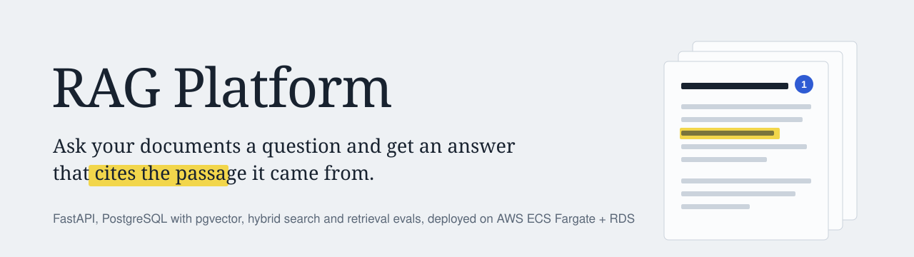
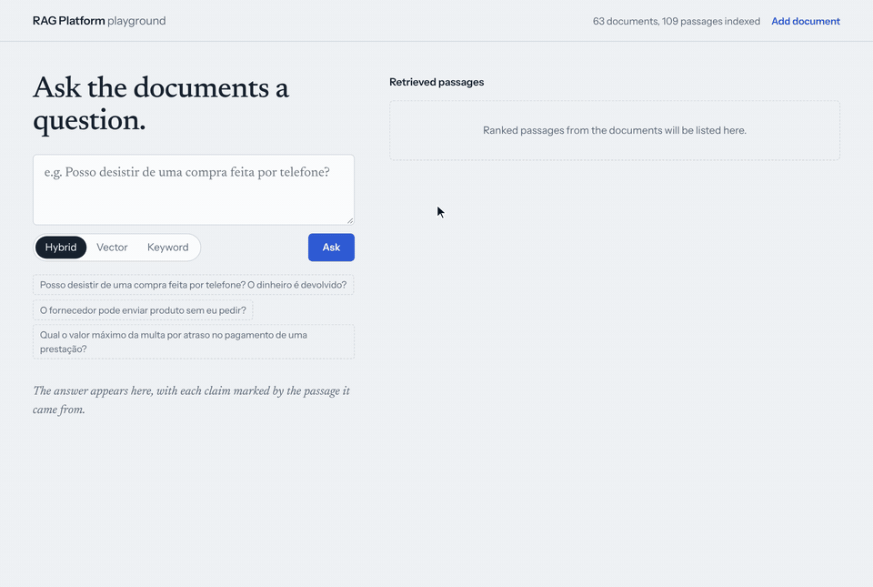
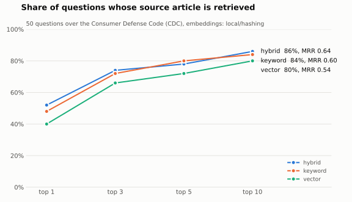
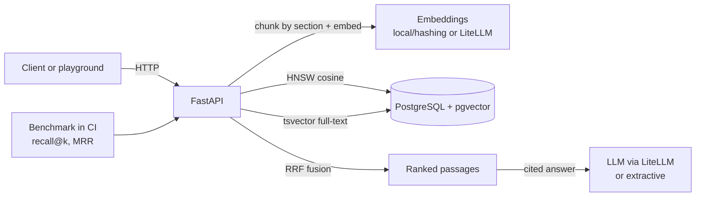

<p align="center"></p>

<p align="center">
  <a href="https://github.com/Mirelasbianchi/rag-platform/actions/workflows/ci.yml"></a>
  <a href="https://github.com/Mirelasbianchi/rag-platform/actions/workflows/deploy.yml"></a>
  
  
</p>

A production-style Retrieval-Augmented Generation API: FastAPI, PostgreSQL with pgvector, hybrid search, cited answers, a web playground, retrieval benchmarks in CI and a Terraform + GitHub Actions deployment to AWS.



<sub>Recorded from the real app running locally. [Full-resolution video (MP4)](docs/assets/demo.mp4).</sub>

## Why

Plenty of RAG tutorials end in a notebook. This project is about what it takes to run RAG as a backend service: a clean API, a real database, tests, containers, CI/CD, cloud deployment, observability, and **numbers that show whether retrieval is actually good**.

## What it does

- **Ingest** text or Markdown (`POST /documents`, `POST /documents/upload`). Markdown is chunked per section, and every chunk carries its heading path, so a passage from *Capítulo VI > Seção I* knows where it came from.
- **Search** three ways (`POST /search`, `mode=vector|keyword|hybrid`): pgvector HNSW cosine search, PostgreSQL full-text search with Portuguese stemming, or both fused with Reciprocal Rank Fusion.
- **Answer** with numbered citations (`POST /ask`). With `LLM_MODEL` set, any model available through LiteLLM writes the answer. Without it, an extractive answer is assembled from the best-matching sentences, so the whole stack runs offline with no API key.
- **Measure**: a benchmark over the Brazilian Consumer Defense Code reports recall@k, MRR and latency for each mode, on every push.

## Retrieval results

50 plain-language questions ("Posso desistir de uma compra feita por telefone?"), each mapped to the article of the [Código de Defesa do Consumidor](https://www.planalto.gov.br/ccivil_03/leis/l8078compilado.htm) that answers it, over 63 articles split into 109 passages.

<p align="center"></p>

| Mode | Recall@1 | Recall@3 | Recall@5 | Recall@10 | MRR@10 | p50 latency |
|---|---:|---:|---:|---:|---:|---:|
| **Hybrid (RRF)** | **0.52** | **0.74** | 0.78 | **0.86** | **0.64** | 6.0 ms |
| Keyword (full-text) | 0.48 | 0.72 | **0.80** | 0.84 | 0.60 | 3.8 ms |
| Vector | 0.40 | 0.66 | 0.72 | 0.80 | 0.54 | 3.8 ms |

*Run on 2026-11-18 with the offline `local/hashing` embeddings, PostgreSQL 16 + pgvector on one machine. Reproduce with the commands below; raw output in [`eval/results/`](eval/results).*

What this shows:

- Fusing keyword and vector rankings beats either one alone at the top of the list (+4 pts recall@1 over keyword, +12 over vector), for about 2 ms more.
- `local/hashing` is a lexical baseline, not a semantic model, so the vector numbers are a floor. Most misses are questions whose words are common to the whole code: *"Quem é considerado consumidor pela lei?"* never reaches Art. 2 in any mode, because almost every article says *consumidor*. Swapping in a semantic embedding model (`EMBEDDING_MODEL=openai/text-embedding-3-small`) is a one-line change, and this benchmark is how to tell whether it pays off.

## Architecture



Deployed on AWS as an ECS Fargate service behind an Application Load Balancer, with RDS for PostgreSQL, ECR, Secrets Manager and CloudWatch, provisioned by [Terraform](infra/terraform) and deployed by GitHub Actions through OIDC. See [`infra/README.md`](infra/README.md).

## API

| Method | Path | Description |
|---|---|---|
| `GET` | `/` | Web playground |
| `GET` | `/health` | Liveness |
| `GET` | `/ready` | Readiness (checks the database), used by the load balancer |
| `POST` | `/documents` | Ingest a document from JSON |
| `POST` | `/documents/upload` | Ingest a `.md` or `.txt` file |
| `GET` | `/documents` | List documents with chunk counts |
| `DELETE` | `/documents/{id}` | Delete a document and its chunks |
| `POST` | `/search` | Top-k passages, `mode` = `hybrid` (default), `vector` or `keyword` |
| `POST` | `/ask` | Answer with numbered citations to the retrieved passages |

```bash
curl -s localhost:8000/ask -H 'content-type: application/json' \
  -d '{"question": "Posso desistir de uma compra feita por telefone?"}'
```

```json
{
  "answer": "O consumidor pode desistir do contrato, no prazo de 7 dias a contar de sua assinatura ou do ato de recebimento do produto ou serviço, sempre que a contratação ... ocorrer fora do estabelecimento comercial, especialmente por telefone ou a domicílio. [1] ...",
  "strategy": "extractive",
  "citations": [{"n": 1, "title": "CDC Art. 49", "source": "cdc:art-49", "score": 0.0325, "...": "..."}],
  "latency_ms": 4.3
}
```

Every response carries `X-Request-ID` and `X-Response-Time-ms`, and every request is logged as one JSON line, ready for CloudWatch Logs Insights.

## Getting started

Requires Docker and [uv](https://docs.astral.sh/uv/). No API key needed.

```bash
git clone https://github.com/Mirelasbianchi/rag-platform.git
cd rag-platform
docker compose up --build                       # API + playground on http://localhost:8000
uv run python eval/ingest_corpus.py             # load the 63 CDC articles
uv run python eval/retrieval_eval.py            # benchmark the three modes
```

To use hosted models, copy `.env.example` to `.env` and set `EMBEDDING_MODEL` and/or `LLM_MODEL` with the matching API key. After changing the embedding model, recreate the database volume (`docker compose down -v`), since stored vectors are not comparable across models.

Run the API outside Docker:

```bash
docker compose up -d db
uv sync
uv run uvicorn app.main:app --reload
uv run pytest
```

## Project structure

```
rag-platform/
├── app/
│   ├── main.py           # routes
│   ├── retrieval.py      # vector, keyword and hybrid (RRF) retrieval
│   ├── answer.py         # cited answers: LLM or extractive
│   ├── embeddings.py     # local/hashing or any LiteLLM embedding model
│   ├── rag.py            # Markdown-aware chunking
│   ├── db.py             # PostgreSQL + pgvector access
│   ├── observability.py  # JSON request logs, latency headers
│   └── static/           # playground (plain HTML, no build step)
├── db/init.sql           # schema, HNSW and GIN indexes
├── eval/                 # CDC corpus, 50 questions, benchmark and chart scripts
├── infra/terraform/      # AWS: ECS Fargate, RDS, ALB, ECR, Secrets Manager, OIDC
└── .github/workflows/    # CI (tests, benchmark on pgvector, Terraform) and deploy
```

## Roadmap

- [x] API, schema, Docker, CI
- [x] Markdown-aware chunking and document management
- [x] Hybrid search (pgvector + full-text) with Reciprocal Rank Fusion
- [x] `/ask` with citations, LLM or offline extractive
- [x] Retrieval benchmark over a public Brazilian legal corpus, run in CI
- [x] Web playground
- [x] Structured logs, latency headers, readiness probe
- [x] AWS deployment (ECS Fargate + RDS) with Terraform and GitHub Actions OIDC
- [ ] Semantic embeddings comparison (OpenAI, multilingual open models) on the same benchmark
- [ ] Reranking with a cross-encoder
- [ ] Answer faithfulness eval (are the citations really supporting the answer?)
- [ ] Database migrations with Alembic
- [ ] Load test and write-up

## Corpus license

The evaluation corpus is Title I of Lei nº 8.078/1990 (Código de Defesa do Consumidor), from planalto.gov.br. Brazilian statutes are not protected by copyright (Lei nº 9.610/1998, art. 8º, IV).

## License

MIT
