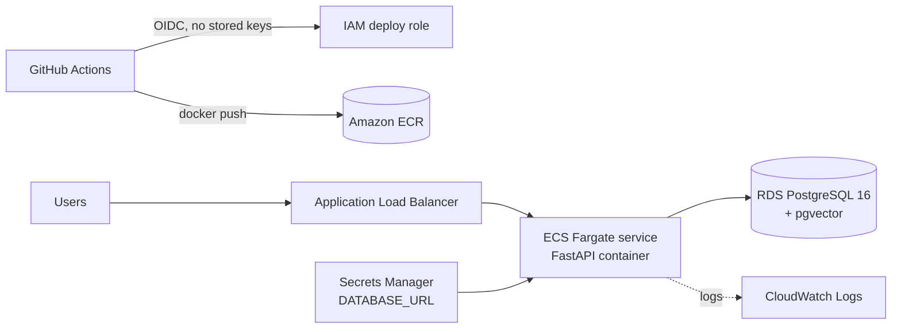

# Infrastructure (AWS)

Everything the API needs on AWS is described in [`terraform/`](terraform):



| Piece | Resource |
|---|---|
| Container registry | ECR with image scanning, keeps the last 10 images |
| Compute | ECS Fargate, 0.25 vCPU / 0.5 GB, deployment circuit breaker with rollback |
| Database | RDS for PostgreSQL 16 (`db.t4g.micro`), pgvector created on boot, private to the tasks |
| Traffic | Application Load Balancer, health check on `/ready` |
| Secrets | `DATABASE_URL` in Secrets Manager, injected into the task |
| Logs | CloudWatch log group `/ecs/rag-platform`, 14-day retention, JSON lines |
| CI/CD | GitHub OIDC provider + a deploy role limited to this repo's `main` branch |

## First deploy

Requires the AWS CLI logged in to your account and Terraform ≥ 1.6.

```bash
cd infra/terraform
terraform init
terraform apply            # ~10 min, mostly RDS
terraform output           # url, ecr_repository, github_deploy_role_arn
```

Then in GitHub, **Settings → Secrets and variables → Actions → Variables**, add:

| Variable | Value |
|---|---|
| `AWS_ROLE_ARN` | `terraform output -raw github_deploy_role_arn` |
| `AWS_REGION` | the region you applied in (default `us-east-1`) |

Run the **Deploy to AWS** workflow once (Actions tab → *Run workflow*). From then on every
green CI run on `main` builds the image, pushes it to ECR, rolls out a new task definition,
waits for the service to be healthy and smoke-tests `/ready`.

Load the demo corpus into the deployed API:

```bash
uv run python eval/ingest_corpus.py --url "$(terraform -chdir=infra/terraform output -raw url)"
```

## Observability

Request latency per route with CloudWatch Logs Insights on `/ecs/rag-platform`:

```
fields @timestamp, path, status, duration_ms
| filter msg = "request"
| stats pct(duration_ms, 50) as p50, pct(duration_ms, 95) as p95, count() by path
```

## Cost and teardown

At on-demand prices in `us-east-1` this runs at roughly **US$ 35–45 per month**: the load
balancer and the Fargate task are most of it, and the RDS instance may be covered by the
free tier on new accounts. Check the AWS pricing pages for current numbers.
`terraform destroy` removes everything (the database has no final snapshot).

If your account already has the GitHub OIDC provider, apply with
`-var create_github_oidc_provider=false`.
